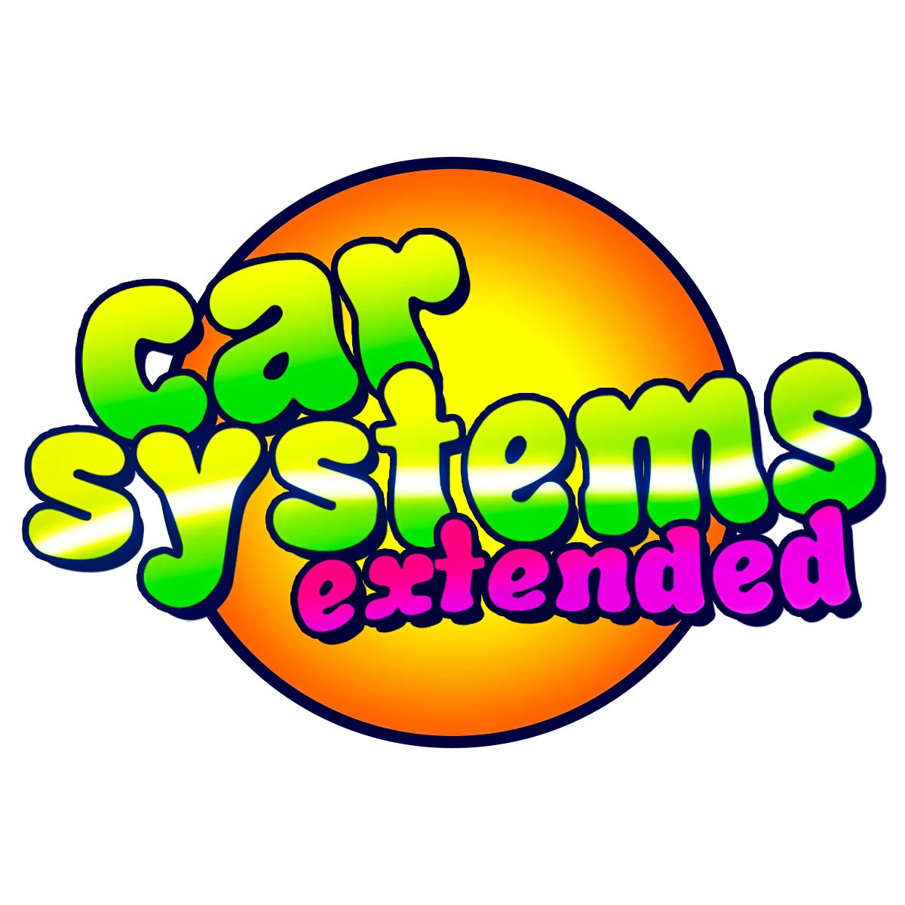

<p align="center">
  
</p>

<p align="center">
  <b>A 1995-style aftermarket car alarm, central locking and remote start for the Satsuma in My Summer Car.</b><br>
  <a href="#english">English</a> · <a href="#русский">Русский</a>
</p>

---

## English

Car Systems Extended is a [MSCLoader](https://github.com/piotrulos/MSCModLoader) mod for **My Summer Car**. It is the successor of my earlier mod *Key System Extended*, rebuilt from scratch: every component is a real part you order from a mail-order catalog, bolt in with the game's wrenches and wire up with the game's wiring mess, and every system runs on the game's own simulation.

### Features
- **Mail-order catalog** — order kits from the *Autotarvike* brochure, post the order at Teimo's, collect the parcel at the post office the next day, cash on delivery.
- **Real installation** — parts snap onto their spots and are held by bolts driven by the game's wrench and ratchet logic; wiring is laid point to point with the wiring mess; 15 A fuse, ground through the mounting bolts.
- **VARTIJA 95 alarm** — remote on the Satsuma keyring, arm/disarm with chirps and indicator flashes, shock / door / bonnet / ignition / movement sensors, 30 s siren, pager trill on the remote, alarm memory, dash status LED, realistic battery drain.
- **Central locking** — a lock actuator in each door; locked doors cannot be opened from outside.
- **Remote start** — two-way remote, starts in neutral with the handbrake on, warms up to a set temperature or time limit, brake-pedal takeover with the hazards, optional automatic choke servo.
- Save/load, English and Russian, in-game reset, debug overlay and mount editor.

### Installation
1. Install MSCLoader (built and tested with 1.4.2).
2. Remove *Key System Extended* if you have it.
3. Put `CarSystemsExtended.dll` into the game's `Mods` folder.

Release builds are on Nexus Mods.

### Building from source
Requires the .NET SDK (any recent version; the project targets .NET 3.5 and compiles against the game's own Mono libraries, so no reference-assembly packages are needed).

```
dotnet build CarSystemsExtended -c Release -p:GameDir="C:\Path\To\My Summer Car"
```

`GameDir` defaults to `D:\SteamLibrary\steamapps\common\My Summer Car`. The build copies the DLL into the game's `Mods` folder.

### Repository layout
| Path | |
|---|---|
| `CarSystemsExtended/` | The mod |
| `CarSystemsExtended/Assets/` | Embedded icon and textures |
| `CSE.Research/` | Debug tool that dumps the game's PlayMaker FSMs to text files (used while developing, not shipped) |
| `TESTING.md` | In-game test checklist |
| `MODELS.md` | Spec for the part models |

---

## Русский

Car Systems Extended — мод для **My Summer Car** на [MSCLoader](https://github.com/piotrulos/MSCModLoader). Это продолжение моего мода *Key System Extended*, написанное с нуля: каждый компонент — настоящая деталь, которую вы заказываете по почтовому каталогу, прикручиваете игровыми ключами и подключаете игровым инструментом wiring mess, а все системы работают на собственной симуляции игры.

### Возможности
- **Почтовый каталог** — заказ комплектов по брошюре *Autotarvike*, отправка у Теймо, получение посылки на почте на следующий день, оплата наложенным платежом.
- **Настоящая установка** — детали ставятся на свои места и держатся на болтах, которые крутятся игровыми ключами и трещоткой; проводка от точки к точке через wiring mess; предохранитель 15 А, масса через болты крепления.
- **Сигнализация VARTIJA 95** — брелок на ключах Сатсумы, постановка и снятие с чирпами и миганием поворотников, датчики удара / дверей / капота / зажигания / движения, сирена 30 с, пейджер на брелке, память тревоги, светодиод на торпеде, реалистичный расход аккумулятора.
- **Центральный замок** — активатор в каждой двери; запертую дверь не открыть снаружи.
- **Автозапуск** — двусторонний брелок, запуск на нейтрали с ручником, прогрев до заданной температуры или времени, передача управления через педаль тормоза с аварийкой, сервопривод подсоса по желанию.
- Сохранения, английский и русский языки, сброс из игры, отладочная панель и редактор мест крепления.

### Установка
1. Установите MSCLoader (собрано и проверено на 1.4.2).
2. Удалите *Key System Extended*, если он стоит.
3. Положите `CarSystemsExtended.dll` в папку `Mods` игры.

Готовые сборки — на Nexus Mods.

### Сборка из исходников
Нужен .NET SDK (любой свежий; проект собирается под .NET 3.5 против библиотек Mono из самой игры, пакеты reference assemblies не нужны).

```
dotnet build CarSystemsExtended -c Release -p:GameDir="C:\Путь\К\My Summer Car"
```

По умолчанию `GameDir` — `D:\SteamLibrary\steamapps\common\My Summer Car`. Сборка сама копирует DLL в папку `Mods` игры.

---

MIT License · © 2026 qniman
